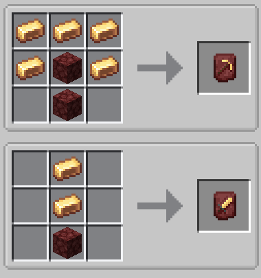
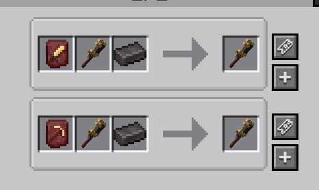

# My Wrench

> 给 Create 的扳手准备了两条锻造升级路线：一条让它成为趁手的武器，一条让它变成万能工具。
> 物品还是那把 Create 扳手，所以原有的扳手交互一个都不会丢。

**支持版本：** Minecraft 1.21.1 · NeoForge 21.1.228
**前置模组：** Create 6.0.10（Ponder / Flywheel 随 Create 自带）

---

## 特性
- **第一人称动画**：装了 Punchy / HyperPunchy 之类的动画模组时，扳手会使用剑的攻击动画。

## 怎么用

1. 合成一张升级模板（合成配方见下）。
2. 把 **模板 + 扳手 + 下界合金锭** 放进锻造台，输出一把升级后的扳手。
3. 想要两种能力就再放一次另一张模板。

升级后的扳手会多出一行金色说明，提示它获得了哪种强化。

## 配置文件

第一次启动后会在 `config/mywrench-common.toml` 生成配置：

- 战斗：开关、攻击伤害（总数值）、攻击速度（最终数值）
- 工具：开关、破坏速度倍率、是否生效于需要正确工具的方块
- 也可以一键关闭「必须先锻造」的限制，只做测试用

---

# My Wrench

> Two smithing upgrade paths for the Create wrench: one turns it into a proper weapon, the other into an all-purpose tool.
> It is still the very same Create wrench, so every existing wrench interaction keeps working.

**Supported:** Minecraft 1.21.1 · NeoForge 21.1.228
**Requires:** Create 6.0.10 (Ponder / Flywheel ship with Create)

---

## Features

- **First-person animations** — with animation mods such as Punchy / HyperPunchy installed, the wrench uses sword attack animations.

## How to use

1. Craft an upgrade template (recipe below).
2. Place **template + wrench + netherite ingot** in a smithing table to get the upgraded wrench.
3. Apply the other template afterwards to combine both bonuses.

An upgraded wrench shows a gold tooltip line telling you which reinforcement it has.

## Config

`config/mywrench-common.toml` is generated on first launch:

- combat: toggle, total attack damage, final attack speed
- tool: toggle, breaking speed multiplier, whether blocks requiring the correct tool drop
- a switch to disable the "must be upgraded first" gate, for testing only
